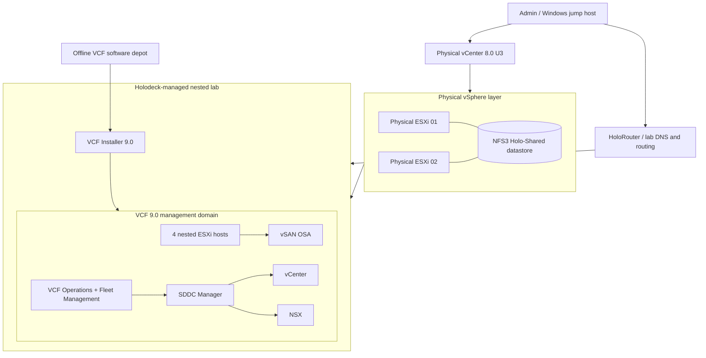

# High-Level Design (HLD) — VMware Cloud Foundation 9.0 on Holodeck

> **Document status:** As-built lab architecture | **Version:** 1.0 | **Date:** 2026-10-28
>
> **Privacy:** All IP addresses, DNS names and subnets in this document are fictionalised equivalents used consistently with the public [runbook](RUNBOOK.md). This is a lab reference, not a production-ready deployment blueprint.

## 1. Executive overview

The solution implements a **single-site VCF 9.0 management domain** on a nested VMware Holodeck 9.0 environment. Two physical VMware ESXi 8.0 U3 hosts run a conventional physical vCenter 8.0 U3 management layer and share a dedicated NFS datastore. Holodeck provisions four nested ESXi 9.0 hosts plus the VCF Installer. The resulting VCF management domain integrates vCenter, vSAN OSA, NSX, SDDC Manager, VCF Operations and Fleet Management.

**Recorded outcome:** VCF management-domain deployment reached 100% completion; VCF Operations displayed **Good** health with **0 critical issues**. These are as-built lab observations, not availability guarantees.

## 2. Objectives, scope and constraints

| In scope | Out of scope |
|---|---|
| Physical ESXi preparation and nested vSphere infrastructure | Production disaster recovery, SLAs and formal security certification |
| Shared NFS backing storage over dedicated 10 Gb connection | Multi-site VCF or additional workload domains |
| Holodeck 9.0 automated nested provision and management-domain installation | Production workload migration |
| Offline software depot and VCF 9 Day-0 binaries | Enterprise PKI, advanced backup orchestration |
| DNS/NTP, logical network segmentation and build validation | Production NSX edge topology and external north–south routing |

**Design constraints:** Two nonidentical physical hosts (~478 GB combined RAM); nested/unsupported-for-production topology; direct 10 Gb interconnects; physical HA and DRS deliberately disabled; VCF nested management domain uses vSAN OSA.

## 3. High-level architecture

**Important layer distinction:** The **physical NFS3 datastore** stores and supports the nested VMs; the **nested VCF management cluster** uses **vSAN OSA**. These are separate storage layers and must not be described as one shared vSAN datastore.

## 4. Architecture domains

### 4.1 Compute and management

- **Physical layer:** Dell PowerEdge T440 (~318.6 GB RAM) and Dell Precision T7910 (~159.9 GB RAM), both ESXi 8.0 U3.
- **Physical management:** vCenter 8.0 U3, `Homelab-DC` and `HomeLab-Cluster`.
- **Nested layer:** Holodeck 9.0 provisions four nested ESXi VMs and the VCF Installer appliance.
- **VCF layer:** A management domain (`mgmt-a`) with `cluster-mgmt-01a`, virtual management services and nested vSAN OSA.

### 4.2 Network and routing

One direct 10 Gb link supports the Holodeck VLAN trunk via `vSwitch-Holo`/`Holo-Trunk` (VLAN 4095, MTU 9000 at the physical trunk). A separate direct 10 Gb connection (`vmnic3`) carries NFS storage traffic via `vSwitch-NFS` and VMkernel `vmk1` (MTU 9000). HoloRouter provides access between the jump environment and isolated VCF lab networks. Nested VLANs separate ESXi management, vSAN, vMotion and NSX tunnel endpoint functions.

### 4.3 Storage

An Ubuntu NFS server presents approximately 1.4 TB of data-disk capacity and an NFSv3 export `/srv/nfs/holodeck`, mounted by **both physical ESXi hosts** as `Holo-Shared` (~1.38 TB visible datastore). Nested vSAN OSA resides **inside** the VCF management domain.

### 4.4 Platform services and software supply

The **Offline Depot** is an nginx-hosted repository serving VCF Day-0 software. VCF Download Tool **9.1.1.0.25713929**, authorised through a Software Depot ID/activation-code workflow, downloaded **seven install binaries totaling ~53 GB**. The VCF Installer consumed the generated Holodeck JSON spec and locally served software.

## 5. Logical network design

| Segment | VLAN | Anonymised example subnet | MTU | Purpose |
|---|---:|---|---:|---|
| Physical lab management | Physical LAN | `192.168.77.0/24` | As configured | Physical ESXi, vCenter, HoloRouter, depot |
| Dedicated physical NFS | Dedicated point-to-point network | `10.77.20.0/24` | 9000 | Physical ESXi ↔ NFS server |
| Nested ESXi management | 10 | `10.77.1.0/24` | 1500 | VCF management |
| Nested vSAN | 11 | `10.77.2.0/25` | 8000 | VCF vSAN |
| Nested vMotion | 13 | `10.77.3.0/25` | 8000 | Live migration |
| Nested NSX TEP | 14 | `10.77.3.128/25` | 8000 | Overlay tunnel endpoints |
| Nested installer access | Routed lab segment | `10.77.10.0/24` | Per lab configuration | Installer and jump-host access |

All values are illustrative; consistent address mappings, gateway and name resolution must be preserved when adapting the runbook.

## 6. Availability, operational model and security

- **Resilience:** Both physical hosts access shared NFS, but physical HA/DRS are disabled and the Ubuntu NFS server is a single point of failure. No production RTO/RPO is claimed.
- **Operations:** VCF Operations monitors discovered VCF inventory and health; SDDC Manager manages domain state and VCF workflows.
- **Security:** Credentials, activation codes and entitlement tokens remain outside version control. Nested VLAN trunking requires promiscuous mode, forged transmits and MAC changes; limit these policies to the lab-specific port group. HTTP offline depot configuration is a documented **lab-only exception**; use supported HTTPS and proper certificates for hardened environments.
- **Observability:** Health in VCF Operations, task progress in VCF Installer, and platform/domainmanager logs form the evidence chain.
- **Lifecycle:** Back up configuration before physical ESXi upgrades; maintain a verified software depot and consistent management services.

## 7. Build flow and acceptance criteria

| Stage | High-level activity | Evidence / completion criterion |
|---|---|---|
| 1 | Prepare two physical hosts, vCenter, trunk and NFS | Shared datastore visible on both hosts; MTU validation |
| 2 | Configure HoloRouter and Holodeck | Precheck completes |
| 3 | Provision four nested ESXi hosts and installer | VMs created and reachable |
| 4 | Stage authorised Day-0 binaries in offline depot | Catalog returns HTTP 200; seven binaries staged |
| 5 | Import management-domain JSON and validate | DNS/NTP and installer validation pass |
| 6 | Deploy VCF management domain | Installer reports 100% successful |
| 7 | Verify platform inventory and health | Domain active; VCF Operations Good / zero critical |

## 8. Key risks and design decisions

| Decision / risk | Reason and implication |
|---|---|
| Nested VCF rather than bare-metal | Practical training, not a supported production reference |
| External physical NFS datastore | Shared backing storage for nested VMs; depends on Ubuntu NFS availability |
| Physical DRS/HA disabled | Simplifies the lab, reduces physical-layer resilience |
| VLAN 4095 + security-policy exceptions | Required for nested networking; restrict use to dedicated trunk |
| HTTP depot exception | Worked around lab installer/depot limitations; not recommended for production |
| Anonymous documentation | Real IPs and screenshots deliberately withheld from public artifacts |

## 9. Related project artifacts

- [Low-Level Design — LLD](LLD.md)
- [Command-by-command runbook](RUNBOOK.md)
- [Public illustrated build page](https://mahesant.github.io/VCF/)

*Design classification: public, anonymised lab as-built; validate software support and hardware sizing separately for any production design.*
