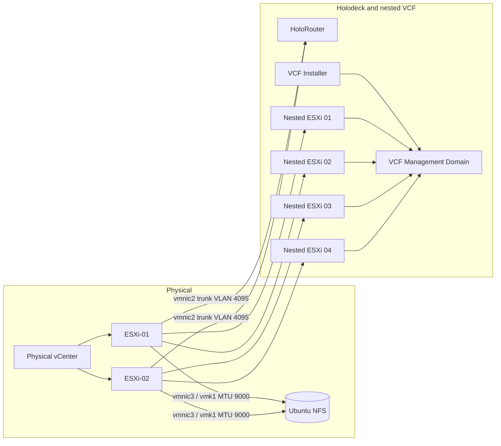

# Low-Level Design (LLD) — VCF 9.0 / Holodeck 9.0

> **Version:** 1.0 | **As-built reference:** Public VCF lab runbook | **Date:** 2026-10-28
>
> **Sanitisation notice:** Addresses and FQDNs are fabricated but internally consistent with [RUNBOOK.md](RUNBOOK.md). Some instance-specific generated filenames are examples. Never paste credentials or real IPs into a public repository.

## 1. Bill of materials and configuration inventory

| Item | Quantity | As-built version / specification | Purpose |
|---|---:|---|---|
| Dell PowerEdge T440 | 1 | ESXi 8.0 U3; ~318.6 GB RAM | Physical host |
| Dell Precision T7910 | 1 | ESXi 8.0 U3; ~159.9 GB RAM | Physical host |
| Physical vCenter | 1 | vCenter 8.0 U3 | Physical infrastructure management |
| Ubuntu NFS VM | 1 | 2 vCPU, 4 GB RAM, 32 GB OS, 1.4 TB data | Shared physical datastore |
| Direct 10 Gb networks | 2 logical functions | `vmnic2` trunk, `vmnic3` NFS | Dedicated fabric separation |
| HoloRouter | 1 | `holorouter-9.0.0.ova` | Lab routing/DNS/trunks |
| Nested ESXi | 4 | Provisioned by Holodeck 9.0 | VCF management cluster |
| VCF Installer | 1 | VCF 9.0 | Management-domain workflow |
| Offline Depot | 1 | nginx + VCF Download Tool 9.1.1 | Staged installation binaries |

Observed physical total RAM: **~478.5 GB**. No per-nested-host vCPU/RAM allocations were recorded publicly; obtain those from the actual deployment spec before reproducing exact sizing.

## 2. Physical and nested topology



**Placement is schematic:** The exact distribution of each nested VM across physical hosts was not published. The diagram illustrates a possible balanced arrangement rather than verified VM placement.

## 3. IP address plan (anonymised)

| Component | Illustrative address / name | Network |
|---|---|---|
| Physical ESXi 01 | `192.168.77.20` | Physical LAN |
| Physical ESXi 02 | `192.168.77.21` | Physical LAN |
| Physical vCenter | `192.168.77.22` | Physical LAN |
| HoloRouter | `192.168.77.23` | Physical LAN |
| Offline depot | `192.168.77.24` | Physical LAN |
| NFS management | `192.168.77.25` | Physical LAN |
| NFS storage | `10.77.20.10/24` | Dedicated NFS |
| ESXi-01 NFS vmk1 | `10.77.20.1/24` | Dedicated NFS |
| ESXi-02 NFS vmk1 | `10.77.20.2/24` | Dedicated NFS |
| Physical management gateway | `192.168.77.1` | Physical LAN |
| VCF Installer | `10.77.10.250` | Routed lab network |
| DNS/NTP for generated spec | `10.77.1.1` | Nested management |
| SDDC Manager | `10.77.1.5` | Nested management |
| SDDC Manager FQDN | `sddcmanager-a.site-a.example.test` | Lab-only DNS |
| vCenter FQDN | `vc-mgmt-a.site-a.example.test` | Lab-only DNS |
| NSX FQDN | `nsx-mgmt-a.site-a.example.test` | Lab-only DNS |
| VCF Operations FQDN | `ops-a.site-a.example.test` | Lab-only DNS |
| Fleet Management FQDN | `opslcm-a.site-a.example.test` | Lab-only DNS |

Anonymised VLAN/subnet allocation:

| Port group / role | VLAN ID | CIDR | MTU |
|---|---:|---|---:|
| Physical trunk `Holo-Trunk` | 4095 (guest trunk) | Multiple nested segments | 9000 physical vSwitch |
| Nested ESXi Management | 10 | `10.77.1.0/24` | 1500 |
| Nested vSAN | 11 | `10.77.2.0/25` | 8000 |
| Nested vMotion | 13 | `10.77.3.0/25` | 8000 |
| Nested NSX TEP | 14 | `10.77.3.128/25` | 8000 |
| Installer access | Routed segment | `10.77.10.0/24` | Lab-dependent |

Confirm jumbo-frame encapsulation end to end, including guest VMkernel ports and the 10 Gb path. The physical NFS and nested traffic MTUs intentionally differ.

## 4. Physical ESXi standard switches

**On both physical hosts:**

```bash
# Nested VLAN trunk
esxcli network vswitch standard add -v vSwitch-Holo
esxcli network vswitch standard set -v vSwitch-Holo -m 9000
esxcli network vswitch standard uplink add -v vSwitch-Holo -u vmnic2
esxcli network vswitch standard portgroup add -v vSwitch-Holo -p Holo-Trunk
esxcli network vswitch standard portgroup set -p Holo-Trunk -v 4095
esxcli network vswitch standard portgroup policy security set -p Holo-Trunk -a true
esxcli network vswitch standard portgroup policy security set -p Holo-Trunk -m true
esxcli network vswitch standard portgroup policy security set -p Holo-Trunk -f true

# Dedicated NFS
esxcli network vswitch standard add -v vSwitch-NFS
esxcli network vswitch standard set -v vSwitch-NFS -m 9000
esxcli network vswitch standard uplink add -v vSwitch-NFS -u vmnic3
esxcli network vswitch standard portgroup add -v vSwitch-NFS -p NFS-Network
esxcli network ip interface add -i vmk1 -p NFS-Network
esxcli network ip interface set -i vmk1 -m 9000
```

Host-specific VMkernel IPv4 commands:

```bash
# ESXi-01
esxcli network ip interface ipv4 set -i vmk1 -I 10.77.20.1 -N 255.255.255.0 -t static

# ESXi-02
esxcli network ip interface ipv4 set -i vmk1 -I 10.77.20.2 -N 255.255.255.0 -t static

# Validate from ESXi-01; reverse target on ESXi-02
vmkping -I vmk1 -s 8972 -d 10.77.20.2
```

**Note:** VLAN 4095 and promiscuous / MAC security exceptions are lab-only and should never be applied indiscriminately to production port groups.

## 5. NFS server and datastore

Ubuntu VM: 2 vCPU, 4 GB RAM, 32 GB OS, 1.4 TB data, storage NIC `ens34` on `10.77.20.10/24` MTU 9000. NFSv3 `Holo-Shared`.

```bash
sudo apt update && sudo apt install -y nfs-kernel-server
sudo mkdir -p /srv/nfs/holodeck
# Format/mount the intended data disk only after verifying device identity.
sudo exportfs -ra
sudo exportfs -v

# On each physical ESXi host
esxcli storage nfs add -H 10.77.20.10 -s /srv/nfs/holodeck -v Holo-Shared
esxcli storage filesystem list
```

The lab export uses:

```text
/srv/nfs/holodeck 10.77.20.1(rw,sync,no_subtree_check,no_root_squash) 10.77.20.2(rw,sync,no_subtree_check,no_root_squash)
```

**Security note:** `no_root_squash` is a privileged lab setting. Restrict NFS exposure to the isolated storage network. The detailed disk partition, UUID mount and export steps are in [RUNBOOK.md](RUNBOOK.md).

## 6. Physical vCenter inventory and Holodeck automation

| Object | Configured value |
|---|---|
| Datacenter | `Homelab-DC` |
| Cluster | `HomeLab-Cluster` |
| Cluster services | DRS Off; HA Off; physical vSAN Off |
| Shared datastore | `Holo-Shared` |
| HoloRouter OVA | `holorouter-9.0.0.ova` |
| HoloRouter DNS domain | `site-a.example.test` |
| Holodeck release | 9.0 |
| Holodeck target API | `VirtualCenter` |
| Holodeck datastore / portgroup | `Holo-Shared` / `Holo-Trunk` |

```powershell
Get-Command New-HoloDeckInstance -Syntax
Get-Command New-HoloDeckConfig -Syntax
Start-HoloDeckPrecheck -Version "9.0"
New-HoloDeckInstance `
  -Version "9.0" `
  -ManagementOnly `
  -ProvisionOnly
```

Generated nested objects were named `pink-esx-01a` through `pink-esx-04a` and `pink-vcfinstaller-a`. The deployment specification was saved at:

```text
/holodeck-runtime/specs/management_domain_config_spec_for_vcf_installer.json
```

Keep the Holodeck configuration JSON private if it includes passwords or other secrets.

## 7. Offline depot design and Day-0 supply chain

| Parameter | Value |
|---|---|
| Offline Depot | `192.168.77.24` (anonymised) |
| Web server | nginx |
| Web root | `/var/www/build` |
| VCF Download Tool | `9.1.1.0.25713929` |
| Offline binaries | 7 installation artifacts; ~53 GB |
| Catalog check | `/PROD/metadata/productVersionCatalog/v1/productVersionCatalog.json` |
| HTTP catalog result | `HTTP/1.1 200 OK` |

Binaries: SDDC Manager, VCF Automation, VCF Operations, Fleet Management, NSX, Operations Cloud Proxy / Collector and vCenter.

```bash
~/vdt-9.1.1/bin/vcf-download-tool configuration generate --software-depot-id

~/vdt-9.1.1/bin/vcf-download-tool binaries download \
  --depot-download-activation-code-file=/home/admin/vcf-activation-code.txt \
  --depot-store=/home/admin/vcf90-depot \
  --vcf-version=9.0.0.0 --sku=VCF \
  --automated-install --type=INSTALL

sudo mkdir -p /var/www/build/PROD
sudo cp -a /home/admin/vcf90-depot/PROD/. /var/www/build/PROD/
curl -I http://127.0.0.1/PROD/metadata/productVersionCatalog/v1/productVersionCatalog.json
```

A lab-only installer override allowed HTTP in `/opt/vmware/vcf/lcm/lcm-app/conf/application-prod.properties` via `lcm.depot.adapter.httpsEnabled=false` and `systemctl restart lcm`. **Prefer HTTPS with valid certificates** in any real deployment; the override is an observed workaround, not a production recommendation.

## 8. Generated VCF management domain

| Object | Value |
|---|---|
| VCF release | 9.0.0.0 |
| Management domain | `mgmt-a` |
| Management cluster | `cluster-mgmt-01a` |
| ESXi | Four nested hosts |
| vSAN datastore | `vsan-mgmt-01a` |
| vSAN architecture | OSA |
| Control plane components | VCF vCenter, NSX, SDDC Manager, VCF Operations, Fleet Management |

**Build sequence:** Holodeck generates JSON spec → import in VCF Installer → review/validate DNS, NTP, networks → deploy vCenter → deploy SDDC Manager → configure nested cluster and vSAN → deploy NSX → deploy Fleet Management and VCF Operations → verify.

## 9. DNS, NTP and jump-host routing

The generated JSON expected lab DNS/NTP `10.77.1.1`, while an initial VCF Installer setting used `10.77.10.129`. Persistent files included `/etc/systemd/network/10-eth0.network` and `/etc/ntp.conf`.

**Correct the current anonymised value (do not search for the original private value):**

```bash
sudo cp /etc/systemd/network/10-eth0.network /etc/systemd/network/10-eth0.network.bak
sudo cp /etc/ntp.conf /etc/ntp.conf.bak
sudo sed -i 's/^DNS=10\.77\.10\.129$/DNS=10.77.1.1/' /etc/systemd/network/10-eth0.network
sudo sed -i 's/^server 10\.77\.10\.129$/server 10.77.1.1/' /etc/ntp.conf
sudo networkctl reload
sudo networkctl reconfigure eth0
sudo systemctl restart systemd-resolved
sudo systemctl restart ntpd
resolvectl status eth0
ntpq -pn
```

Windows jump-host routes:

```powershell
route -p add 10.77.10.0 mask 255.255.255.0 192.168.77.23
route -p add 10.77.1.0 mask 255.255.255.0 192.168.77.23
ipconfig /flushdns
```

## 10. Test and acceptance matrix

| ID | Validation | Method | Observed result |
|---|---|---|---|
| T01 | Dedicated 10 Gb NFS MTU | `vmkping -I vmk1 -s 8972 -d <peer>` | Configured and validated during lab build |
| T02 | Shared physical datastore | Check `Holo-Shared` visible on both hosts | Met |
| T03 | Holodeck provisioning | Precheck and `New-HoloDeckInstance` output | Four nested ESXi hosts + installer created |
| T04 | Offline depot entitlement | Seven binaries downloaded | ~53 GB successfully staged |
| T05 | Catalog availability | `curl -I` on catalog | HTTP 200 |
| T06 | Installer validation | VCF UI DNS/NTP/network checks | Passed after corrections |
| T07 | Domain deployment | VCF Installer progress | 100%, successful |
| T08 | Domain inventory | SDDC Manager and VCF Operations | 4 ESXi, 1 vCenter, 1 vSAN cluster, 1 NSX |
| T09 | Platform health | VCF Operations health summary | Good; 0 critical issues |

Where raw console evidence or exact timestamps were not retained in the public documents, do not infer more precise performance/availability measurements.

## 11. Monitoring, supportability, rollback

**Troubleshooting:**

```bash
tail -F /var/log/vmware/vcf/domainmanager/domainmanager.log
tail -F /var/log/vmware/vcf/lcm/lcm.log
find /var/log/vmware/vcf/domainmanager -name vcsa-cli-installer.log -type f
```

**Recovery boundaries:** Take physical host configuration backups before upgrades; retain Holodeck configuration securely; maintain NFS export and mount evidence; keep an inventory of the staged depot binaries. A tested end-to-end VCF restore procedure, backups of all management VMs and formal DR are **not documented** and must not be assumed.

**Known issues resolved:** (1) Password special characters affecting Holodeck URI handling, (2) software depot HTTP 403 despite authentication, (3) installer DNS/NTP mismatch, (4) lab HTTP offline-depot setting.

## 12. References

- [HLD](HLD.md)
- [Runbook and original command evidence](RUNBOOK.md)
- [Public VCF build walkthrough](https://mahesant.github.io/VCF/)

*These configurations are for learning and interview portfolio demonstration only. Revalidate current Broadcom guidance and support constraints prior to production use.*
